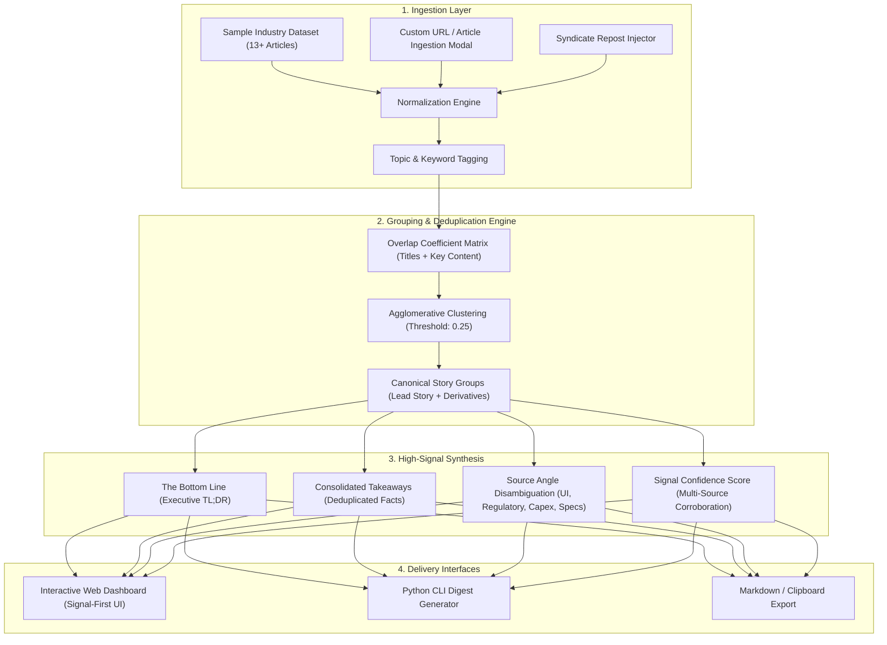

# ⚡ Information Overload Eliminator (SignalBrief)

> **Eliminating repetitive industry noise. Delivering verifiable executive signal in under 3 minutes.**

---

## 🎯 Problem Statement
Professionals and executives face massive information overload:
- Major industry developments (e.g. model releases, chip architectures, regulatory updates) spawn dozens of near-identical articles, newsletters, and social media posts.
- Reading 15 redundant articles takes 25–35 minutes, creating cognitive exhaustion without adding new signal.
- Critical nuances (like specific contract terms, licensing deals, or technical limitations) are buried across competing outlets.

---

## 🚀 The Solution: SignalBrief
**SignalBrief** is a personalized news briefing prototype that:
1. **Ingests** multi-source feeds, URLs, newsletters, or manual submissions.
2. **Filters** by custom industry topics (AI, Semiconductors, Policy & Regulation) or real-time keywords.
3. **Groups & Deduplicates** repetitive articles covering the exact same development using title/content overlap coefficient clustering.
4. **Synthesizes Key Takeaways**: Extracting a 1-sentence "Bottom Line" and consolidated bullet points.
5. **Provides Verifiable Source Links**: Maps every contributing publication with its specific reporting angle and clickable citation.
6. **Quantifies Signal vs. Noise**: Shows exact percentage of noise eliminated and reading time saved.

---

## 📐 System Architecture



---

## 🔬 Sample Dataset Breakdown (Included in MVP)

| Topic | Primary Story | Contributing Outlets | Extracted Nuances |
| :--- | :--- | :--- | :--- |
| **Artificial Intelligence** | OpenAI Launches Search in ChatGPT | The Verge, Reuters, TechCrunch, Search Engine Land | • Interface & citation format<br>• Media licensing deals (News Corp, Axel Springer)<br>• Paid subscriber tier rollout<br>• SEO referral disruption |
| **Hardware & Semiconductors** | Nvidia Unveils Blackwell Ultra B300 Chips | Tom's Hardware, ServeTheHome, Bloomberg | • 288GB HBM3e memory specs<br>• GB300 NVL72 liquid-cooled racks<br>• Hyperscaler $200B capex driver |
| **Policy & Regulation** | European Union AI Act Compliance Rules | Financial Times, Politico EU, The Register | • GPAI code of practice<br>• 10^25 FLOP compute threshold<br>• Up to 7% global turnover fines |
| **Artificial Intelligence** | Anthropic Claude 3.5 Sonnet Computer Use API | Wired, VentureBeat, Ars Technica | • Desktop UI pixel interaction<br>• Enterprise pilot partners<br>• Hands-on latency & safety quirks |

**Result:** **13 raw articles** collapsed into **4 actionable executive developments** (**69% noise eliminated**, saving ~26 minutes of reading time).

---

## 💻 Quick Start & Running the Prototype

### Option 1: Direct in Browser (Zero Dependencies)
Simply open `index.html` in any web browser:
```bash
# Windows
start index.html
```

### Option 2: Run via Local Python Server
```bash
python server.py
# Open http://localhost:8080 in your browser
```

### Option 3: Run the CLI Briefing Engine
```bash
python briefing_engine.py sample_data.json
```

---

## ⚙️ Core Technical Features
- **Overlap Coefficient (Szymkiewicz–Simpson)**: Computes `intersection / min(|A|, |B|)` which correctly identifies derivative articles even when lengths differ dramatically.
- **Dynamic Sensitivity Slider**: Allows users to toggle clustering threshold from strict duplicate suppression (0.35) to broad story grouping (0.20).
- **Source Nuance Extraction**: Automatically tags whether an outlet focused on *Regulatory Compliance*, *Technical Architecture*, *Licensing Deals*, *Hands-on Testing*, or *Capex Impact*.
- **One-Click Markdown Export**: Formats synthesized digests into instant Slack/Email-ready briefing memos.
